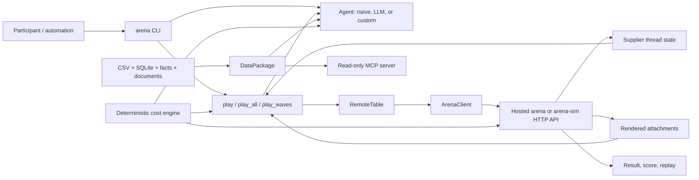
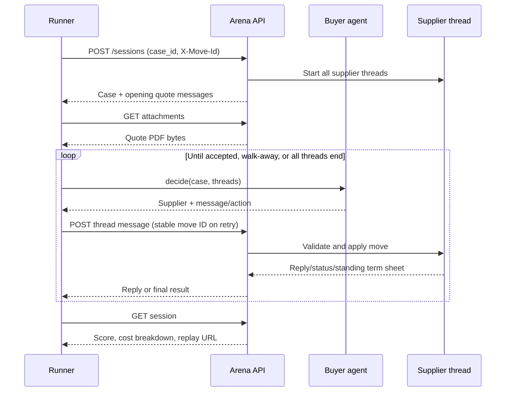
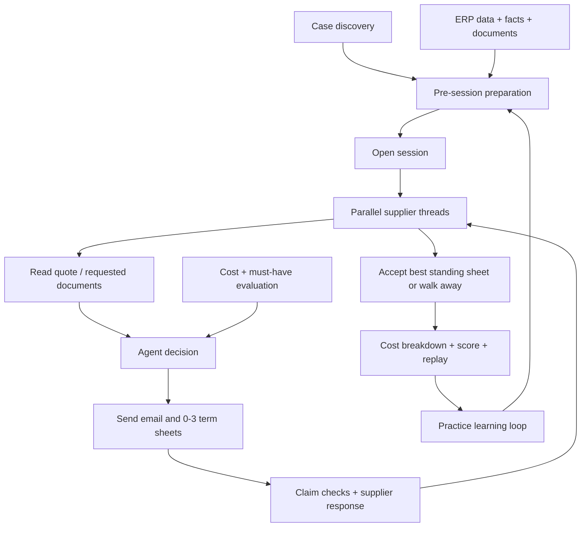
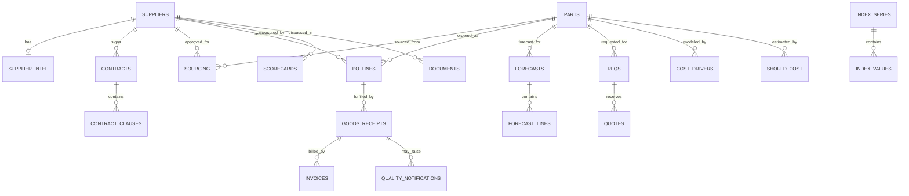

# Tacto Negotiation Arena: Codebase Knowledge

> Repository-wide architecture and maintenance guide. Generated from the repository state inspected on 2026-10-10. Paths are relative to the repository root. Source anchors use `[[F:path#line-range#hash8]]`; `hash8` is the first eight characters of the file's SHA-256 at analysis time. Re-check an anchor when its hash changes.

## How to use this document

- Start with **High-Level Overview** to understand the product and business model.
- Use **Architecture and Runtime Flows** before changing orchestration, API calls, timeouts, or concurrency.
- Use **Feature Reference** to find entry points, collaborators, side effects, and tests.
- Read **Things You Must Know Before Changing Code** before editing deal economics, agent safeguards, the simulator, or data access.
- Use **Deep Reference** for schemas, endpoints, symbols, environment variables, and extension recipes.

## Executive summary

This repository is a challenge kit for the Tacto Negotiation Arena. Participants act as the procurement team of fictional pump maker Hollerau Pumpenwerke and build an autonomous buyer agent that prepares from procurement data, negotiates by email with supplier bots, and accepts the lowest-total-cost valid deal or walks away. The repository supplies the public contract and domain data; the hosted supplier intelligence itself is intentionally outside this repository. [[F:README.md#15-22#ed1439e4]] [[F:brief/brief.md#27-52#ee2293f3]]

The executable product is a small Python 3.12 package under `starter-kit/`. It contains:

- an HTTP API client;
- orchestration for one case, parallel practice cases, and five-wave finals;
- deterministic deal-cost and must-have evaluation;
- document extraction for PDF/XLSX attachments;
- a deliberately weak deterministic buyer and an example LLM buyer;
- read-only procurement-data access plus an MCP façade;
- an in-memory FastAPI simulator and three simulation cases;
- contract/unit tests that also can target a hosted arena. [[F:starter-kit/pyproject.toml#1-30#f14cef1d]] [[F:starter-kit/README.md#170-188#d97b8bc0]]

The central architectural idea is: **language models write and reason about the negotiation, while ordinary code validates terms, computes money, handles deadlines, retries network calls, and enforces basic safety checks**. [[F:starter-kit/arena_kit/agents/llm.py#1-10#a93030c5]] [[F:brief/brief.md#219-229#ee2293f3]]

## 1. High-Level Overview

### 1.1 Business purpose and users

The primary users are hackathon teams building buyer agents. Secondary users are maintainers validating the public contract and developers using the simulator/MCP server to integrate their own agent. The business scenario covers industrial procurement, where price, supply continuity, working capital, freight, lead time, quality, tooling, indexation, and supplier sustainability can all affect the best outcome. [[F:context/PROCUREMENT.md#1-37#81ae1da0]] [[F:brief/api.md#377-426#68286119]]

Hollerau Pumpenwerke is modeled as a €252M, 910-person German pump manufacturer. The detailed procurement world covers 46 material suppliers and 60 important parts; the wider spend cube adds a long tail. Standard policy is 60-day payment, 8% capital cost, DAP preference, dual sourcing for qualified A-parts, and explicit approval and quality thresholds. [[F:data/company.md#1-30#1b553d63]]

### 1.2 Business features

| Feature | Business need | Technical center |
|---|---|---|
| Case discovery and preparation | Understand the mandate, suppliers, need, alternative, constraints, and evidence before the 60-second clock starts | `GET /v1/cases`, `DataPackage`, `LLMAgent.prepare` |
| Email negotiation | Conduct realistic, explainable supplier conversations instead of exchanging only numbers | `play`, agent `decide`, message endpoint |
| Multi-variable term sheets | Trade cheap-to-buyer terms for supplier concessions and reveal supplier preferences with alternatives | `complete_offer`, API term validation, up to three sheets |
| Evidence-backed arguments | Convert ERP history, market indices, scorecards, documents, and should-cost into verifiable leverage | `facts.json`, `DataPackage`, claim IDs and `claim_results` |
| Commercial evaluation | Compare offers on total cost rather than unit price | `cost.py`, result cost breakdown, score formula |
| Safe closure | Accept only a current standing term sheet or use the alternative/walk away | `closing_move`, `LLMAgent.guard`, message actions |
| Parallel RFQ and event execution | Negotiate with multiple suppliers/cases inside concurrency and wave caps | `play_all`, `play_waves`, `RemoteTable` |
| Practice and learning | Use scores, traces, supplier reasons, and replay pages to improve the agent | session result/replay, simulator leaderboard |
| Local integration testing | Validate the client contract without quota/network/hosted suppliers | `arena-sim`, `S01`-`S03`, contract tests |
| Model-accessible procurement data | Let an agent query structured and unstructured evidence without write access | `DataPackage`, six MCP tools |

The features form a closed learning loop: discover case → prepare evidence → open supplier threads → evaluate/communicate → close → inspect score and replay → improve preparation and decisions. [[F:brief/brief.md#79-81#ee2293f3]]

### 1.3 Repository boundaries

| Area | Responsibility | Important boundary |
|---|---|---|
| `brief/` | Normative participant, API, and submission documentation | More complete than the local simulator for hosted/final-only behavior |
| `context/` | Procurement-domain background and a short challenge context | Explanatory, not runtime input |
| `data/` | Canonical data package: CSV, SQLite, facts, contracts, correspondence | Snapshot as of 2026-09-30; synthetic company data plus real open market series |
| `starter-kit/arena_kit/` | Executable Python package | Client-side kit, not the hosted arena implementation |
| `starter-kit/tests/` | Unit and API-contract coverage | Hosted contract tests are opt-in through environment variables |
| `starter-kit/data/package/` | A second untracked copy of the data package in this working tree | Runtime/downloaded artifact; do not edit as canonical source |
| `codebase-analysis-docs/` | This analysis and its Mermaid sources | Documentation only |

`CLAUDE.md` is stale: it says no application code exists, while `starter-kit/arena_kit/` and its tests are present. Treat the actual tree, `pyproject.toml`, tests, and brief as authoritative. [[F:CLAUDE.md#5-8#3b47932d]]

### 1.4 Technology stack

- Python `>=3.12,<3.13`, packaged with Hatchling and managed/documented through `uv`.
- Runtime core: `httpx`, `openpyxl`, `pypdf`.
- Optional integrations: Anthropic SDK, MCP 2.x, FastAPI/Uvicorn.
- Development: pytest and Ruff; Ruff targets Python 3.12 with `E`, `F`, `I`, `B`, and `UP` rules.
- Storage: UTF-8 CSV, SQLite opened read-only, JSON facts/cases, Markdown documents.
- Runtime style: synchronous client and agent interface; thread pools for case-level concurrency; FastAPI for the simulator. [[F:starter-kit/pyproject.toml#1-30#f14cef1d]]

### 1.5 Architectural style

The kit is a compact layered library with functional-domain modules rather than a server-side application:

1. `cli.py` is the user-facing composition root.
2. `client.py` is a transport gateway.
3. `play.py` is the application/orchestration layer.
4. `agents/` implements interchangeable decision policies.
5. `cost.py`, `docs.py`, and `data.py` are deterministic domain/services modules.
6. `sim.py` is a separate adapter that implements much of the public API in memory.

No dependency-injection framework, ORM, migrations, durable application database, background queue, or web frontend exists. The only shared interface expected of an agent is duck-typed: `decide(case, threads) -> {supplier_id, message}`. [[F:starter-kit/arena_kit/play.py#1-9#ee2e0450]]

### 1.6 Phase 1 state block

**Decisions/Findings.** Treat `starter-kit/` as the executable product, `brief/api.md` as the hosted public contract, and `data/` as the canonical data snapshot. Treat the untracked `starter-kit/data/package/` as a runtime duplicate and `CLAUDE.md`'s repository-state description as obsolete.

**Open Questions.** Hosted supplier/arena internals and the event's unresolved jury details are not recoverable from this repository.

**Next Steps.** Trace the client, orchestration, cost, agents, data, documents, and simulator as one end-to-end runtime.

```yaml
INDEX_VERSION: "2026-10-10/source-hashes-below"
FILE_MAP_SUMMARY: "Python SDK/runner/simulator under starter-kit; normative docs under brief; 24-table procurement snapshot under data; 618 non-git/non-venv files including the untracked duplicate data package"
OPEN_QUESTIONS:
  - "The repository does not contain hosted supplier-bot or hosted arena source code."
  - "The jury-weighting placeholders in the event documentation were unresolved in this snapshot."
KNOWN_RISKS:
  - "CLAUDE.md describes an obsolete empty-repository state."
  - "starter-kit/data/package is untracked and duplicates data/."
GLOSSARY_DELTA:
  arena: "Hosted negotiation service or its local contract simulator"
  case: "One commercial negotiation with one to three supplier threads"
  term_sheet: "The only binding structured package of commercial terms"
```

## 2. Architecture and Runtime Flows

### 2.1 Component map

The editable Mermaid source is `codebase-analysis-docs/assets/system-architecture.mmd`.



`cost.py` is shared conceptually by both sides: locally the agent/runner uses it to compare packages, while the simulator uses it to calculate authoritative local results. The hosted service has its own implementation and returns exact result numbers. [[F:starter-kit/arena_kit/cost.py#1-8#697010bc]] [[F:starter-kit/arena_kit/sim.py#27-28#df9a22cd]]

### 2.2 Single-case data flow

The editable source is `codebase-analysis-docs/assets/negotiation-sequence.mmd`.



Detailed mechanics:

1. `RemoteTable.open` calls `ArenaClient.open_session`; every supplier has an independent opening thread. [[F:starter-kit/arena_kit/play.py#36-53#ee2e0450]]
2. `play` eagerly downloads and extracts all supplier attachments before the first decision. Each subsequent reply is enriched the same way. [[F:starter-kit/arena_kit/play.py#142-151#ee2e0450]]
3. The agent receives the entire in-memory `case` and `{supplier_id: [messages...]}` structure. It chooses exactly one live supplier and returns an email or closing action. [[F:starter-kit/arena_kit/play.py#152-167#ee2e0450]]
4. Non-closing moves are posted; the reply is appended after the buyer message. A `409` is reconciled by re-reading session/thread state because it may represent a timeout, wave cap, or ended thread. [[F:starter-kit/arena_kit/play.py#168-181#ee2e0450]]
5. An accept or walk-away goes through the same message endpoint and yields the result. [[F:starter-kit/arena_kit/play.py#64-69#ee2e0450]]

### 2.3 Transport, retries, and pacing

`ArenaClient` creates an `httpx.Client` rooted at `<ARENA_URL>/v1`, optionally with `X-API-Key`. Every POST receives a fresh random `X-Move-Id`; retries reuse that header so a network retry cannot replay a commercial move. Calls share a lock-protected pacer set to nine calls/second, one below the published ten-call limit. [[F:starter-kit/arena_kit/client.py#33-61#fd15a08f]]

The client retries transport failures and statuses 429/500/502/503/504 up to three times. A 429 is retried only when it has a numeric `Retry-After` of at most five seconds; quota and open-session 429s intentionally surface immediately. The default HTTP timeout is 180 seconds because one request can include supplier thinking plus serialization behind another session call. [[F:starter-kit/arena_kit/client.py#10-24#fd15a08f]] [[F:starter-kit/arena_kit/client.py#60-84#fd15a08f]]

### 2.4 Concurrency and final waves

`play_all` uses a `ThreadPoolExecutor`, creates a fresh table and agent per case, isolates exceptions as result values, and uses a shared event to stop launching work after a practice-quota error. It does not cancel already-started cases. [[F:starter-kit/arena_kit/play.py#196-221#ee2e0450]]

`play_waves` continuously polls final cases, tracks each wave's current cap from `seconds_left`, starts unseen cases in the same executor, and keeps the deadline as a callable so host extensions update running games. A case closes 90 seconds before cap, or earlier when the slowest observed round plus 15 seconds is larger. [[F:starter-kit/arena_kit/play.py#24-30#ee2e0450]] [[F:starter-kit/arena_kit/play.py#224-256#ee2e0450]]

Crash recovery is final-specific: if opening a final case returns a 409 naming its existing session, `RemoteTable` can resume only when constructed with the case object, as `play_waves` does. It reconstructs every thread and returns an already-finished result if applicable. [[F:starter-kit/arena_kit/play.py#42-62#ee2e0450]]

### 2.5 Authentication, authorization, and secret handling

- Hosted requests use one team key in `X-API-Key`; simulator registration issues simulator-only keys. [[F:brief/api.md#34-45#68286119]]
- `.env` loading never overwrites a real environment variable. `.env.example` documents variables without values, and submission rules explicitly prohibit committing keys. [[F:starter-kit/arena_kit/cli.py#18-27#7469d159]] [[F:brief/submission.md#5-15#e3b7b5c2]]
- The simulator authenticates API requests by looking up the key in its in-memory `teams`; registration and public pages are exceptions. [[F:starter-kit/arena_kit/sim.py#525-535#df9a22cd]]
- During the live final, agents must not consume leaderboards, results, screens, or event feeds. The CLI runner does not call them; users extending it must preserve that rule. [[F:README.md#79-89#ed1439e4]]

### 2.6 Logging, caching, and persistence

Logging uses the single `arena` logger. Verbose CLI mode enables INFO; otherwise WARNING. Per-case exceptions are logged with stack traces, slow decisions warn after 45 seconds, and unknown evidence IDs removed by the LLM guard are logged. [[F:starter-kit/arena_kit/cli.py#83-88#7469d159]] [[F:starter-kit/arena_kit/play.py#153-180#ee2e0450]]

There is no general cache. `DataPackage` memoizes its ID index and cases with `cached_property`; the CLI forces ID-index construction once before shared use. The simulator is entirely in memory, so restarting loses teams, sessions, idempotency records, quota history, and leaderboard state. [[F:starter-kit/arena_kit/data.py#59-74#5ab54163]] [[F:starter-kit/arena_kit/cli.py#29-41#7469d159]] [[F:starter-kit/arena_kit/sim.py#107-115#df9a22cd]]

### 2.7 Phase 2 state block

**Decisions/Findings.** The stable boundaries are transport (`client.py`), orchestration (`play.py`), strategy (`agents/`), deterministic domain services (`cost.py`, `docs.py`, `data.py`), and the local API adapter (`sim.py`).

**Open Questions.** The hosted implementation and its supplier-model internals remain intentionally opaque; local parity is limited to implemented routes.

**Next Steps.** Catalog each user-visible feature through entry point, collaborators, data, side effects, and tests.

```yaml
INDEX_VERSION: "2026-10-10/source-hashes-below"
FILE_MAP_SUMMARY: "CLI composes client, runner, agents, data package, MCP, and simulator; cost and document modules are deterministic shared services"
OPEN_QUESTIONS:
  - "Hosted service internals, supplier prompts/models, and deployment are intentionally unavailable."
  - "The local simulator covers the participant-facing negotiation subset, not every documented hosted endpoint."
KNOWN_RISKS:
  - "Simulator state is process-local and non-durable."
  - "Thread-pool concurrency shares one synchronous HTTP client and global rate pacer."
GLOSSARY_DELTA:
  standing_term_sheet: "The supplier offer currently eligible for acceptance"
  move_id: "Idempotency key that must remain stable across retries of one POST"
  wave_cap: "Hard final-event deadline that ends still-open cases without a deal"
```

## 3. Feature Reference

### 3.1 CLI and environment configuration

**Purpose.** Provide a minimal operator interface for registration, discovery, practice/final execution, data download, leaderboard inspection, and MCP serving. [[F:starter-kit/arena_kit/cli.py#49-83#7469d159]]

**Entry points.** `pyproject.toml` exposes `arena = arena_kit.cli:main` and `arena-sim = arena_kit.sim:main`. [[F:starter-kit/pyproject.toml#14-16#f14cef1d]]

**Commands.** `register`, `cases`, `play`, `run`, `data`, `me`, `board`, and `mcp`. `run --set final` selects `play_waves`; other sets select hosted cases and `play_all`. Parallelism is clamped to ten. [[F:starter-kit/arena_kit/cli.py#57-83#7469d159]] [[F:starter-kit/arena_kit/cli.py#119-152#7469d159]]

**Side effects.** Network calls, stdout/stderr output, zip extraction under `--out`, environment loading, and MCP stdio serving. `ZipFile.extractall` trusts server-supplied archive paths; this is acceptable only if the arena download is trusted. [[F:starter-kit/arena_kit/cli.py#112-118#7469d159]]

**Interactions.** Agent creation can share one `DataPackage` and one model-completion callable across per-case `LLMAgent` instances. [[F:starter-kit/arena_kit/cli.py#29-41#7469d159]]

### 3.2 HTTP API client

**Purpose.** Map one Python method to each public API operation while centralizing authentication, rate pacing, timeouts, retry safety, binary responses, and error normalization. [[F:starter-kit/arena_kit/client.py#1-24#fd15a08f]]

**Key types.** `ArenaError(status, detail)` retains machine-readable status and detail. `ArenaClient` exposes registration/team/cases/session/thread/message/attachment/backoffice plus the legacy structured move/accept/walk-away paths, session lists, leaderboard, and downloads. [[F:starter-kit/arena_kit/client.py#27-30#fd15a08f]] [[F:starter-kit/arena_kit/client.py#86-141#fd15a08f]]

**Edge cases.** Binary attachments/downloads return bytes; other methods assume JSON. Error bodies that are not JSON fall back to text. Practice quota remaining is recorded only when a response supplies a numeric header. [[F:starter-kit/arena_kit/client.py#76-84#fd15a08f]]

### 3.3 Negotiation orchestration

**Purpose.** Keep transport and agent strategy separate. `RemoteTable` adapts the HTTP service to `open/send/close/attachment/missed/result`, while pure helpers interpret thread state. [[F:starter-kit/arena_kit/play.py#36-95#ee2e0450]]

**Helpers.** `latest` finds the last supplier message; `standing` reads its first term sheet; `live_threads` excludes only `walked_away` and `no_bid`; `moves_left` counts buyer messages against the round limit; `fetch_documents` mutates attachment objects by adding extracted text. [[F:starter-kit/arena_kit/play.py#97-123#ee2e0450]]

**Deadline closure.** `closing_move` compares standing sheets after filling supplier-standard terms, enforces must-haves, and accepts only a sheet cheaper than a priced alternative; otherwise it walks away. [[F:starter-kit/arena_kit/play.py#126-139#ee2e0450]]

**Hidden dependency.** Correct closure depends on the quote PDF having already been downloaded and parsed; without it, omitted fields fall back to buyer-plan defaults instead of the supplier's true standards. `play` establishes that invariant, but direct callers of `closing_move` must do so themselves.

### 3.4 Deterministic deal economics

**Purpose.** Convert an incomplete supplier term sheet into closing terms, calculate buyer total cost `C`, check must-haves, estimate supplier cash value/relationship risk, and normalize proposed offers. [[F:starter-kit/arena_kit/cost.py#1-8#697010bc]]

**Term precedence.** `closing_terms` starts from buyer-plan defaults, then overlays supplier standards, fixed case terms, and finally supplied terms. This last overlay assumes callers/API validation only supply negotiable fields; direct callers can accidentally override fixed terms. Unknown Incoterm defaults to the costliest buyer freight option. [[F:starter-kit/arena_kit/cost.py#27-44#697010bc]]

**Cost components.** `cost_breakdown` returns price, uncovered need, fallback risk, payment timing, freight, late delivery, quality, tooling, realized index movement, index risk, and relationship charge. `total_cost` returns infinity for a sheet with no price and otherwise rounds the sum to cents. [[F:starter-kit/arena_kit/cost.py#125-167#697010bc]]

**Relationship term.** Only `stabilise` and `secure_supply` categories charge for leaving an estimated supplier below sustainable margin. Without an explicit supplier estimate the relationship component is zero, so client-side ranking can understate `C` relative to the server's exact result. [[F:starter-kit/arena_kit/cost.py#71-122#697010bc]]

**Offer normalization.** `complete_offer` emits exactly negotiable fields, fills gaps from buyer-plan values, chooses the buyer-cheapest Incoterm, snaps values to allowed options, and rounds price to two decimals. [[F:starter-kit/arena_kit/cost.py#189-211#697010bc]]

**Tests.** Unit tests pin the published example, partial coverage/fallback, effective dates, freight, index clauses, quality, relationship softness, infinity without price, option snapping, and must-haves. [[F:starter-kit/tests/test_kit.py#36-132#21fe3957]]

### 3.5 Supplier document ingestion

**Purpose.** Turn attached PDF/XLSX/text bytes into prompt-readable text and recover quote terms by stable labels. [[F:starter-kit/arena_kit/docs.py#1-25#7fc69cce]]

PDFs are text-extracted page by page. XLSX files are opened with formulas preserved as formula strings and flattened sheet/row-wise. Other files are UTF-8-decoded with replacement. `quote_terms` recognizes four sections and eleven labeled term fields, including an index-clause regex. [[F:starter-kit/arena_kit/docs.py#28-72#7fc69cce]]

`standard_terms` scans newest-to-oldest for an attachment whose name starts with `quote` and already has `text`. Renaming quote files or changing rendered labels silently weakens term recovery. [[F:starter-kit/arena_kit/docs.py#75-81#7fc69cce]]

### 3.6 Naive agent

**Purpose.** Supply a deterministic baseline and an emergency fallback, not a competitive strategy. It chooses the live quoted supplier with the lowest locally computed `C`, anchors 10% below price, then halves the gap, and accepts on `agreed`, `final_offer`, exhausted moves, or a gap under 1%. [[F:starter-kit/arena_kit/agents/naive.py#1-5#bf1574b7]] [[F:starter-kit/arena_kit/agents/naive.py#11-51#bf1574b7]]

It deliberately ignores data, documents, commercial trades, alternatives, and walking away. It also evaluates incomplete standing sheets without parsed supplier-standard terms. Do not treat it as a safe final fallback without strengthening it.

### 3.7 LLM agent

**Purpose.** Combine model-written email/strategy with deterministic preparation and output guards. Providers are either Anthropic messages or an OpenAI-compatible `/chat/completions`; both have 45-second timeouts. [[F:starter-kit/arena_kit/agents/llm.py#54-86#a93030c5]]

**Preparation.** Once per new case, `prepare` serializes the full case, up to 2,500 characters of the trigger document, and up to 600 characters for each supplier/part/ref fact. This is the only proactive data retrieval in the example agent; it does not autonomously query related rows or correspondence. [[F:starter-kit/arena_kit/agents/llm.py#95-121#a93030c5]]

**Per-turn prompt.** `render` adds alternative `C`, every live thread's status/moves/standing terms/local `C`/standard terms, the last six messages, and attachment excerpts. This bounds transcript growth but may omit earlier conversational commitments not present in the prepared brief. [[F:starter-kit/arena_kit/agents/llm.py#123-144#a93030c5]]

**Guard.** `guard` validates the selected live supplier, closing actions, must-haves, alternative cost, remaining moves, sheet count, exact/snap-completed terms, evidence IDs, subject length, and body length. Unknown IDs in the recognized ID families are removed from prose. [[F:starter-kit/arena_kit/agents/llm.py#146-193#a93030c5]]

**Fallback.** Any completion, parse, or guard failure returns the `NaiveAgent` decision. This preserves liveness but can bypass the safety property the guard just enforced; see the critical gotchas section. [[F:starter-kit/arena_kit/agents/llm.py#95-104#a93030c5]]

### 3.8 Procurement data access

**Purpose.** Present the canonical package and additive Sunday release through SQL, citable-ID lookup, document reads, and case discovery. [[F:starter-kit/arena_kit/data.py#1-12#5ab54163]]

`DataPackage` resolves its root, loads the first package `facts.json`, merges new release facts with right-hand precedence, opens the first SQLite/DB file using URI `mode=ro`, enables `query_only`, and permits cross-thread use. [[F:starter-kit/arena_kit/data.py#15-36#5ab54163]]

`query` accepts statements whose first token is `SELECT` or `WITH` and fetches at most 200 rows by default. SQLite's `query_only` remains the second defense against a data-changing CTE. [[F:starter-kit/arena_kit/data.py#38-57#5ab54163]]

The lazy ID index scans every table, using `id` or the first column, and adds release CSV rows. `lookup` prefers `facts.json`; `document` resolves body/text/content or a file path and prevents traversal outside the selected package/release root; `cases` recursively finds `cases/**/*.json`. [[F:starter-kit/arena_kit/data.py#59-108#5ab54163]]

### 3.9 MCP server

**Purpose.** Expose `DataPackage` safely to any MCP-capable model/client over stdio. The six tools are `list_tables`, `query`, `lookup`, `list_ids`, `read_document`, and `get_case`, all annotated read-only and closed-world. [[F:starter-kit/arena_kit/mcp_server.py#16-53#40fa2f9e]]

MCP adds no authorization of its own; its security boundary is local process access plus `DataPackage` read-only/path checks. `list_ids` further caps output at 500 even though `DataPackage.ids` itself does not. [[F:starter-kit/arena_kit/mcp_server.py#31-44#40fa2f9e]]

### 3.10 Local simulator

**Purpose.** Reproduce the public negotiation contract closely enough to test clients, agents, documents, errors, timeouts, replay, and scoring without hosted supplier logic. Its one supplier algorithm opens above current/fallback price, concedes a fixed amount, floors price, marks a final offer, and walks when pushed. [[F:starter-kit/arena_kit/sim.py#1-12#df9a22cd]]

**State machine.** `Sim.open` creates a session and one thread per supplier with opening quote PDF; `_tick` advances 60-second timeouts; `message` validates and applies questions/offers/actions; `_settle` ends when all threads close; `_end` calculates local result/cost/score. [[F:starter-kit/arena_kit/sim.py#191-240#df9a22cd]] [[F:starter-kit/arena_kit/sim.py#263-375#df9a22cd]]

**Documents.** It creates minimal PDFs directly and cost-breakdown XLSX workbooks with formulas, storing only metadata until attachment retrieval. [[F:starter-kit/arena_kit/sim.py#44-83#df9a22cd]] [[F:starter-kit/arena_kit/sim.py#377-393#df9a22cd]]

**HTTP adapter.** `create_app` adds request-size middleware, error mapping, authentication, POST rate limiting/idempotency, negotiation endpoints, structured compatibility endpoints, leaderboard, and replay HTML/JSON. A single lock serializes simulator operations. [[F:starter-kit/arena_kit/sim.py#509-696#df9a22cd]]

**Local-only cases.** S01 is a price increase with price/payment; S02 is a two-supplier RFQ with price/payment/lead time; S03 is a renewal with price/payment/duration/Incoterm and a priced alternative. [[F:starter-kit/arena_kit/sim_cases/S01.json#1-67#34cbfef1]] [[F:starter-kit/arena_kit/sim_cases/S02.json#1-76#c802c656]] [[F:starter-kit/arena_kit/sim_cases/S03.json#1-81#610f0eef]]

### 3.11 Tests and verification strategy

`test_kit.py` is primarily fast domain/unit coverage for economics, documents, retries, data safety/releases, LLM prompting/guards, MCP tool registration, quota behavior, and hosted-case filtering. [[F:starter-kit/tests/test_kit.py#1-329#21fe3957]]

`test_sim.py` starts Uvicorn on a free local port and tests both example agents end-to-end, parallel runs, documents, claim deduplication, status codes, idempotency, timeouts/no-clock, replay escaping, structured endpoints, wave polling/caps, late acceptance, and practice quota. The same core agent contract test is parameterized for a hosted arena when `ARENA_TEST_URL` and `ARENA_TEST_KEY` exist. [[F:starter-kit/tests/conftest.py#18-38#778ea457]] [[F:starter-kit/tests/test_sim.py#36-53#58d0743b]]

### 3.12 Cross-feature interaction map

The editable source is `codebase-analysis-docs/assets/feature-interactions.mmd`.



### 3.13 Phase 3 state block

**Decisions/Findings.** Ten feature areas account for the executable surface. The `decide(case, threads)` protocol is the main extension seam, while standards-aware cost evaluation is the main correctness dependency.

**Open Questions.** Real provider calls and every hosted case type are outside deterministic local coverage.

**Next Steps.** Audit non-obvious failure modes, implicit invariants, data quirks, and performance boundaries before presenting the deep reference.

```yaml
INDEX_VERSION: "2026-10-10/source-hashes-below"
FILE_MAP_SUMMARY: "Ten functional feature areas traced through entry points, collaborators, effects, and tests"
OPEN_QUESTIONS:
  - "No tests enumerate every documented case type because hosted case files are API-delivered, not committed."
  - "No end-to-end test exercises a real Anthropic/OpenAI request."
KNOWN_RISKS:
  - "LLM guard failure falls back to a less safe agent."
  - "Document parsing relies on exact human-readable labels and filenames."
GLOSSARY_DELTA:
  claim_result: "verified, irrelevant, contradicted, or duplicate evidence assessment"
  standard_terms: "Supplier defaults applied to fields omitted from its standing sheet"
  alternative: "Priced outcome available if no supplier deal is accepted"
```

## 4. Things You Must Know Before Changing Code

### 4.1 Critical correctness and safety gotchas

1. **The LLM safety guard is not a hard boundary.** If `guard` rejects an unsafe accept, `decide` passes control to `NaiveAgent`. On a `final_offer` or `agreed` message, the naive policy accepts without checking the alternative or must-haves. A safe refactor should make fallback closure use `closing_move`-grade checks or distinguish model failure from rejected action. The current test only covers a rejected accept while the opening status is `open`, so it does not catch this bypass. [[F:starter-kit/arena_kit/agents/llm.py#95-104#a93030c5]] [[F:starter-kit/arena_kit/agents/llm.py#146-169#a93030c5]] [[F:starter-kit/arena_kit/agents/naive.py#23-43#bf1574b7]] [[F:starter-kit/tests/test_kit.py#267-280#21fe3957]]

2. **Fixed-term immutability lives outside `cost.py`.** `closing_terms` overlays caller terms after fixed terms. The HTTP contract prevents a term sheet from containing non-negotiable fields, but direct internal calls can override fixed terms and compute an impossible deal. Validate inputs or change precedence carefully and update tests. [[F:starter-kit/arena_kit/cost.py#27-44#697010bc]] [[F:starter-kit/arena_kit/sim.py#182-189#df9a22cd]]

3. **Supplier standards are economically material.** Omissions are filled from the quote PDF at deal time. Any code comparing or accepting a term sheet must provide parsed standards, or it may assume buyer-plan defaults and rank the wrong supplier. [[F:brief/api.md#273-303#68286119]]

4. **Client-side relationship cost is optional but server scoring is exact.** Strategic/bottleneck ranking without a supplier estimate can favor a commercially unhealthy package whose hosted `C` is higher. The example LLM prompt explicitly warns that displayed `C` omits this term. [[F:starter-kit/arena_kit/agents/llm.py#29-51#a93030c5]]

5. **Term sheets, not prose, bind.** Natural-language promises, engineering variants, or prices do not become deal terms. Never infer an accept target from email text; use the current `term_sheet_id`. [[F:brief/api.md#233-271#68286119]]

### 4.2 Timing and concurrency gotchas

- The 60-second clock is per supplier thread and starts after the supplier reply. Model completion, local data work, attachment fetches, logging, and scheduling consume buyer time. Perform expensive research before opening a session. [[F:brief/api.md#451-460#68286119]]
- `play` warns at 45 seconds but does not cancel a slow `decide`; the underlying provider timeout is also 45 seconds, leaving limited network margin. [[F:starter-kit/arena_kit/play.py#153-162#ee2e0450]] [[F:starter-kit/arena_kit/agents/llm.py#54-84#a93030c5]]
- One shared `ArenaClient` paces all threads globally. Increasing thread-pool size cannot exceed the key-wide request budget and may add queueing latency. [[F:starter-kit/arena_kit/client.py#49-58#fd15a08f]]
- `play_all` returns exceptions as dictionary values; callers must inspect each value rather than assuming a thrown aggregate error. [[F:starter-kit/arena_kit/play.py#196-221#ee2e0450]]
- Final deadlines are derived from repeatedly refreshed `seconds_left`, not a hard-coded eight minutes. Preserve the callable deadline and per-wave `caps` map. [[F:starter-kit/arena_kit/play.py#228-255#ee2e0450]]

### 4.3 Simulator-versus-hosted differences

- The simulator's supplier is a fixed price-concession script; it does not model realistic roles, economics, authority, tone, relevance, or evidence math. Optimizing against it will overfit the plumbing. [[F:starter-kit/arena_kit/sim.py#1-8#df9a22cd]]
- The simulator implements the core negotiation endpoints but not all hosted surfaces documented in `brief/api.md` (for example data-download, events, results, and actual final waves). Its `GET /v1/cases?set=final` always returns 403. [[F:starter-kit/arena_kit/sim.py#571-575#df9a22cd]]
- Simulator rate limiting is applied in `team_of(..., post=True)`, so only POST requests count there, while the published hosted rule says ten calls/second per key and the client paces every method. [[F:starter-kit/arena_kit/sim.py#525-535#df9a22cd]]
- The simulator uses one process-global lock for all teams and calls. This favors deterministic tests over realistic parallel throughput. [[F:starter-kit/arena_kit/sim.py#537-554#df9a22cd]]
- `--no-clock` is strictly a manual-testing convenience. Hosted behavior always retains the timeout rule. [[F:starter-kit/arena_kit/sim.py#704-725#df9a22cd]]

### 4.4 Data and evidence gotchas

- Prices can be per 1, 100, or 1,000 units. A PO value is `qty * price / price_unit`; do not compare raw `price` across parts blindly. [[F:data/KNOWN_ISSUES.md#8-10#eb61b1e4]]
- Delivery performance depends on requested versus first-confirmed dates, and partial receipts count separately. Use the scorecard methodology rather than inventing an OTD definition. [[F:data/SCORECARD.md#3-12#6f749904]]
- `sup:71999` is an obsolete duplicate of renamed `sup:70210`; entity-resolution logic must consolidate deliberately. [[F:data/KNOWN_ISSUES.md#11-12#eb61b1e4]]
- Index series end in different months, should-cost carries 5-15% uncertainty, small-lot PPM is noisy, some PO prices are stale, and old quotes intentionally omit fields. [[F:data/KNOWN_ISSUES.md#12-20#eb61b1e4]]
- Data claims are not rewarded merely for being true. At most three are checked per message, window/relevance rules apply, duplicate evidence is discounted, and sharing a rival quote reveals buyer-private information. [[F:brief/api.md#238-266#68286119]]
- `DataPackage._ids` uses `id` or a table's first column. Tables whose first column is not unique can overwrite entries; citable `facts.json` remains preferred and should be used for arena claims. [[F:starter-kit/arena_kit/data.py#59-78#5ab54163]]

### 4.5 Parsing and prompt gotchas

- `parse` greedily extracts from the first `{` through the last `}`. Multiple JSON objects or prose containing braces can fail JSON parsing and trigger fallback. [[F:starter-kit/arena_kit/agents/llm.py#196-201#a93030c5]]
- The system prompt requests a 120-word body, but code enforces only the API's 8,000-character limit. [[F:starter-kit/arena_kit/agents/llm.py#39-51#a93030c5]] [[F:starter-kit/arena_kit/agents/llm.py#183-191#a93030c5]]
- Evidence scrubbing recognizes only `idx|quote|offer|sc|qn|po|cost|fc|news|doc|ctr`. Supplier and part IDs are context rather than checked evidence and are not scrubbed. [[F:starter-kit/arena_kit/agents/llm.py#27-27#a93030c5]]
- Prompt truncation occurs independently at document/fact/message/attachment boundaries. An extension requiring persistent commitments should add explicit structured memory rather than relying on the last six messages. [[F:starter-kit/arena_kit/agents/llm.py#106-144#a93030c5]]
- XLSX extraction returns formulas as written, not evaluated values. Models must not assume formula cells were calculated. [[F:starter-kit/arena_kit/docs.py#34-42#7fc69cce]]

### 4.6 Performance characteristics

- The largest startup cost in data access is building `_ids`, which scans all rows of all tables; the CLI intentionally warms it once before parallel agents share it. [[F:starter-kit/arena_kit/cli.py#34-41#7469d159]]
- Attachment parsing is synchronous and repeated for each fetched attachment. There is no content hash/cache.
- The SQLite connection uses `check_same_thread=False`; reads are shared without an explicit Python lock. SQLite read-only access is appropriate, but future mutable state must not reuse this assumption. [[F:starter-kit/arena_kit/data.py#29-36#5ab54163]]
- Simulator `c_best` performs a Cartesian product across allowed non-price terms per supplier. Current case option sets are small; adding many negotiable dimensions can make session settlement expensive. [[F:starter-kit/arena_kit/sim.py#285-300#df9a22cd]]

### 4.7 Hard-coded business and protocol rules

| Rule | Location |
|---|---|
| Client pace 9/s; API allowance 10/s | `client.py:14`, `sim.py:31` |
| HTTP timeout 180s | `client.py:17` |
| Buyer move limit 60s | `play.py:26`, `sim.py:31` |
| Final proactive closure 90s; slow-round margin 15s | `play.py:29` |
| Practice quota 200/rolling 24h | `sim.py:32`, API brief |
| Maximum 10 open sessions | `sim.py:31`, API brief |
| Request body 64 KB; email 8,000 chars; up to 3 sheets | `sim.py:31`, `sim.py:366-368` |
| Simulator opens +10%, later suppliers +2%; concedes 2%; floors at 90%; final from round 5 | `sim.py:33`, `sim.py:218-220`, `_answer` |
| Data SQL result cap 200; MCP ID list cap 500 | `data.py:11`, `mcp_server.py:39` |
| LLM/HTTP completion timeout 45s | `agents/llm.py:60`, `agents/llm.py:82` |

### 4.8 Phase 4 state block

**Decisions/Findings.** The highest-risk change areas are LLM fallback closure, fixed/standard-term precedence, per-thread timing, simulator-versus-hosted assumptions, and evidence/data interpretation.

**Open Questions.** Maintainer intent is unclear for the weaker naive fallback and direct fixed-term overrides.

**Next Steps.** Consolidate endpoints, schemas, symbols, glossary, extension recipes, coverage gaps, and stable source anchors.

```yaml
INDEX_VERSION: "2026-10-10/source-hashes-below"
FILE_MAP_SUMMARY: "Risk review covers safety fallbacks, fixed/standard term precedence, deadlines, concurrency, simulator fidelity, evidence, parsing, and data quirks"
OPEN_QUESTIONS:
  - "Whether maintainers intend NaiveAgent to remain the LLM fallback despite weaker closure safety."
  - "Whether fixed-term override in closing_terms is intentional for trusted internal callers."
KNOWN_RISKS:
  - "Rejected LLM accepts can become naive accepts in final/agreed states."
  - "Exact rendered quote labels are an implicit parser API."
GLOSSARY_DELTA:
  c_open: "Lowest valid opening total cost"
  c_best: "Fixed benchmark: best supplier-feasible package or buyer alternative"
  relationship_cost: "Penalty for unsustainably low estimated supplier margin in strategic/bottleneck goals"
```

## 5. Deep Reference

### 5.1 Public HTTP API

Base URL is `https://arena.tacto.ai/v1`. Every POST needs a fresh move ID, reused only for exact retries. Core flow and endpoints are normative in `brief/api.md`. [[F:brief/api.md#1-30#68286119]]

| Method/path | Purpose | Client method | Simulator |
|---|---|---|---|
| `GET /health` | Service health | direct HTTP | yes |
| `POST /v1/register` | Simulator-only key | `register` | yes |
| `GET /v1/me` | Team/quota/best scores | `me` | yes |
| `GET /v1/cases?set=` | Full case discovery | `cases` | yes; no real finals |
| `POST /v1/sessions` | Open case/all supplier threads | `open_session` | yes |
| `GET /v1/sessions?set=` | Team session list | `sessions` | yes |
| `GET /v1/sessions/{sid}` | Session/thread summaries/result | `session` | yes |
| `POST .../threads/{supplier}/messages` | Email/offer/action | `send_message` | yes |
| `GET .../threads/{supplier}` | Full thread/recovery | `thread` | yes |
| `GET .../attachments/{id}` | Binary supplier document | `attachment` | yes |
| `GET .../backoffice` | Post-case supplier-role trace | `backoffice` | placeholder locally |
| `POST .../moves` | Legacy structured offer | `move` | yes |
| `POST .../accept` | Legacy structured close | `accept` | yes |
| `POST .../walk_away` | Legacy structured close | `walk_away` | yes |
| `GET /v1/leaderboard` | Scores/ranks | `leaderboard` | practice subset |
| `GET /v1/data` and `/data/{name}.zip` | Package releases | `downloads`, `download` | no |

Important status meanings: 401 authentication; 403 authorization/window; 404 missing resource; 409 ended/late/limit conflict; 413 oversized body; 422 invalid request with no round consumed; 429 rate/session/quota limit. [[F:brief/api.md#451-472#68286119]]

### 5.2 Case, message, and result shapes

A case carries identity/type/title/briefing, trigger document, parts/suppliers, negotiable/fixed/options, buyer economics, round limit, refs, and optional case-local facts. Supported documented types are `price_increase`, `renewal`, `rfq`, `bundling`, `raw_material`, `capacity`, and `quality`. [[F:brief/api.md#305-340#68286119]]

A buyer message has subject/body, zero to three complete term sheets, up to 20 refs, optional attachments, or an `accept`/`walk_away` action. A supplier message adds role sender, standing sheet, status, signals, missing fields, claim results, and attachment IDs. [[F:brief/api.md#188-205#68286119]]

The final result reports deal/identity/terms, `c_open`, `c_deal`, `c_alt`, `c_best`, score, must-have outcome, component breakdown, and later the supplier-reason trace. [[F:brief/api.md#362-375#68286119]]

### 5.3 Cost model reference

Let `N` be annual need, `H` horizon years, `V` committed annual volume, `M` contract months, and `P` price. Covered volume is `min(V,N) * min(M/12,H)` (single order counts as one year); committed volume can exceed need; uncovered need is purchased at fallback plus category risk. Payment timing is simple interest relative to reference days. Freight, lead-time lateness, expected quality loss net of chargeback, tooling, index exposure/risk, and optional supplier-health penalty are added. [[F:brief/api.md#377-417#68286119]]

Score is `clip((C_open - C_deal) / (C_open - C_best), 0, 1)`. No deal uses `C_alt` when available; broken must-haves score zero. [[F:starter-kit/arena_kit/cost.py#170-186#697010bc]]

### 5.4 Procurement data model

The editable ER source is `codebase-analysis-docs/assets/data-model.mmd`.



The package contains 24 tables and 32,997 rows in this snapshot. Table meaning and published row counts are defined in `data/README.md`; exact columns and foreign keys are in `data/datapackage.json`. [[F:data/README.md#23-58#c711fa7c]]

| Domain | Tables and important joins |
|---|---|
| Supplier master/strategy | `suppliers`; 1:1 `supplier_intel`; M:N `sourcing` to `parts`; `spend_cube` |
| Contracts/prices | `contracts` → `contract_clauses`; `price_conditions`; `negotiation_history` |
| Procure-to-pay | `po_lines` → `goods_receipts` → `invoices` |
| Quality/performance | `goods_receipts` → `quality_notifications`; supplier → quarterly `scorecards` |
| Demand | `parts` → `forecasts` → `forecast_lines` |
| Sourcing events | `parts` → `rfqs` → `quotes` |
| External/commercial intelligence | `index_series` → `index_values`; `cost_drivers`; `should_cost`; `news`; `documents` |

### 5.5 Citable IDs

IDs use `<type>:<id>[@period]`. Claim-checkable families are index, quote, scorecard, quality notification, PO, should-cost, forecast, news, document/notice, contract, and session-local offers. `facts.json` is the arena-checking view and should be treated as canonical for claims; relational rows provide exploration context. [[F:data/README.md#17-21#c711fa7c]] [[F:brief/api.md#341-360#68286119]]

### 5.6 Key symbol catalog

| Symbol | Responsibility |
|---|---|
| `ArenaClient._call` | Pace, retry with stable move ID, decode response, normalize errors |
| `RemoteTable` | Adapt API client to runner operations and crash recovery |
| `play` | Run one complete case and maintain enriched thread history |
| `play_all` | Run case IDs concurrently and contain failures/quota exhaustion |
| `play_waves` | Poll/start/close final cases by changing wave caps |
| `closing_move` | Deadline-safe accept-or-walk-away policy |
| `closing_terms` | Merge buyer defaults, supplier standards, fixed terms, supplied terms |
| `cost_breakdown` / `total_cost` | Deterministic buyer economics |
| `supplier_value` / `relationship_cost` | Estimate supplier-side cash value and sustainability penalty |
| `complete_offer` / `snap` | Produce API-valid proposed sheets |
| `must_haves_ok` / `score` | Validate hard conditions and normalize outcome |
| `read_document` / `quote_terms` / `standard_terms` | Extract attachment text and structured quote defaults |
| `DataPackage` | Read-only package/release access |
| `NaiveAgent.decide` | Deterministic price-only baseline |
| `LLMAgent.prepare/render/guard/decide` | Prompt preparation, decision context, output safety, fallback |
| `llm_from_env` | Anthropic or OpenAI-compatible completion adapter |
| `build` in `mcp_server.py` | Register six read-only data tools |
| `Sim` | In-memory arena/supplier/session state machine |
| `create_app` | FastAPI adapter with auth, limits, idempotency, and routes |
| `replay_html` | Escaped human-readable replay rendering |

### 5.7 Environment and operational commands

| Variable | Meaning |
|---|---|
| `ARENA_URL` | Hosted or simulator base URL, without `/v1` requirement |
| `ARENA_API_KEY` | Team or simulator key |
| `ARENA_DATA` | Unpacked base package directory |
| `ARENA_RELEASE` | Optional Sunday-release directory override |
| `LLM_PROVIDER` | `anthropic` or anything routed through OpenAI-compatible code |
| `LLM_MODEL` | Required provider model identifier |
| `LLM_EFFORT` | Optional Anthropic output effort |
| `ANTHROPIC_API_KEY` | Read by Anthropic SDK |
| `LLM_BASE_URL` | OpenAI-compatible API base; defaults to OpenAI |
| `LLM_API_KEY` | Bearer token for compatible endpoint |
| `ARENA_TEST_URL`, `ARENA_TEST_KEY` | Enable hosted contract-test parameter |

Common commands from `starter-kit/`:

```bash
uv sync --all-extras
uv run pytest
uv run ruff check .
uv run arena-sim serve --no-clock --data data/package
uv run arena cases
uv run arena play case:P01 --agent llm -v
uv run arena run --set practice --agent llm --parallel 8
uv run arena run --set final --agent llm --parallel 10
uv run arena mcp --data data/package
```

### 5.8 Extension recipes

**Add a custom agent.** Implement `decide(case, threads)`, return one live supplier and a valid message/action, then wire it into `agent_factory` or call `play` directly. Reuse `standing`, `standard_terms`, `complete_offer`, `total_cost`, `must_haves_ok`, and `closing_move`; add unit tests plus a simulator end-to-end test. [[F:starter-kit/README.md#139-168#d97b8bc0]]

**Add a negotiable field.** Update the API/case schema source, `docs.LABELS` and `_value`, cost semantics/defaults, simulator validation/rendering, example cases, and cost/document/contract tests. Avoid adding a field to `LABELS` without defining whether it is numeric, integer, date/string, or a structured clause.

**Add a data table.** Add CSV/schema/SQLite generation upstream, relations in `datapackage.json`, citable facts only if the arena validates them, MCP documentation as needed, and tests for lookup/query/document semantics. `DataPackage.tables` discovers tables automatically.

**Change API behavior.** Update `brief/api.md` first as the public contract, then `ArenaClient`, simulator route/state behavior, and `test_sim.py`. If hosted behavior is available, run the opt-in hosted contract test before release.

**Change scoring.** Treat `brief/api.md`, `cost.py`, simulator `_end`, and the cost tests as one atomic compatibility surface. Add numeric examples that pin every new component and edge case.

### 5.9 Test coverage map and gaps

Strong coverage exists for the pure cost functions and the local negotiation contract. Important untested or lightly tested areas are:

- CLI output/argument branches and data ZIP extraction;
- malformed/empty PDFs, unusual XLSX workbooks, or renamed quote headings;
- real provider authentication/error shapes and OpenAI-compatible variations;
- safe fallback on rejected `final_offer`/`agreed` accepts;
- `DataPackage` behavior with multiple databases/facts files, duplicate first-column IDs, and concurrent queries under load;
- long-running real final recovery across a process restart;
- all hosted-only endpoints and supplier behavior.

### 5.10 Glossary

| Term | Meaning |
|---|---|
| Agent | Object implementing `decide(case, threads)` |
| Arena | Hosted negotiation API; sometimes the compatible local simulator |
| BATNA / alternative | Best available outcome if no negotiated deal closes |
| Buyer plan defaults | Values derived from need/reference terms when neither supplier standard nor case/sheet supplies one |
| Case | One negotiation with a mandate and one to three supplier threads |
| Category goal | `stabilise`, `secure_supply`, `quality_first`, `leverage`, or `routine`; selects economics/risk emphasis |
| Claim | Evidence-backed sentence tied to one or more citable IDs |
| Closing terms | Effective deal after sheet, standards, and fixed values are merged |
| C | Total buyer cost over the case horizon |
| Citable ID | Stable package/session identifier the arena can validate |
| Final offer | Supplier status warning that further pressure may end the thread; still requires explicit acceptance |
| Must-have | Hard predicate; violation makes deal score zero |
| Offer ID / term-sheet ID | Identifier of a supplier's standing package |
| PPM | Defective parts per million |
| Practice quota | 200 session starts per team in a rolling 24-hour window |
| Ref | Citable data ID declared or embedded in an email |
| Round | One buyer message in one supplier thread; opening supplier message is round zero |
| Standard terms | Supplier defaults for any terms omitted from its offered sheet |
| Standing offer | Current supplier term sheet eligible for accept |
| Thread | Ordered buyer/supplier message stream for one supplier within a case |
| Wave | Group of hidden final cases with a shared announced theme/cap |

### 5.11 Priority file index

`LINES` is textual line count (`world.sqlite` is binary and shown by physical newline count only). Generated caches, venv files, individual contracts/correspondence, and the duplicate untracked package are intentionally excluded.

| # | Priority | Path | Type | Lines | Hash8 | Why it matters |
|---:|:---:|---|---|---:|---|---|
| 1 | +++ | `starter-kit/arena_kit/play.py` | Python | 256 | ee2e0450 | Core orchestration, concurrency, deadlines |
| 2 | +++ | `starter-kit/arena_kit/cost.py` | Python | 211 | 697010bc | Authoritative client-side economics |
| 3 | +++ | `starter-kit/arena_kit/agents/llm.py` | Python | 201 | a93030c5 | Example intelligent agent and guards |
| 4 | +++ | `starter-kit/arena_kit/client.py` | Python | 141 | fd15a08f | Transport, retries, rate limiting |
| 5 | +++ | `starter-kit/arena_kit/sim.py` | Python | 725 | df9a22cd | Local contract implementation |
| 6 | +++ | `brief/api.md` | Contract docs | 472 | 68286119 | Normative HTTP/business contract |
| 7 | +++ | `starter-kit/tests/test_kit.py` | Tests | 329 | 21fe3957 | Domain invariants |
| 8 | +++ | `starter-kit/tests/test_sim.py` | Tests | 308 | 58d0743b | End-to-end contract invariants |
| 9 | +++ | `starter-kit/arena_kit/data.py` | Python | 108 | 5ab54163 | Read-only evidence/data boundary |
| 10 | +++ | `starter-kit/arena_kit/cli.py` | Python | 156 | 7469d159 | Composition root and operator UX |
| 11 | ++ | `brief/brief.md` | Product docs | 229 | ee2293f3 | Business purpose, rules, score |
| 12 | ++ | `starter-kit/arena_kit/docs.py` | Python | 81 | 7fc69cce | Attachment and standard-term parsing |
| 13 | ++ | `starter-kit/arena_kit/mcp_server.py` | Python | 61 | 40fa2f9e | Model-facing data tools |
| 14 | ++ | `starter-kit/arena_kit/agents/naive.py` | Python | 51 | bf1574b7 | Baseline and failure fallback |
| 15 | ++ | `data/datapackage.json` | JSON schema | 1791 | 929ba312 | Exact relational schemas/keys |
| 16 | ++ | `data/facts.json` | JSON data | 78943 | 7dc162f9 | Canonical citable facts |
| 17 | ++ | `data/world.sqlite` | SQLite | binary | 9d20d6a3 | Queryable 24-table snapshot |
| 18 | ++ | `data/README.md` | Data docs | 74 | c711fa7c | Data meanings and joins |
| 19 | ++ | `data/company.md` | Domain docs | 47 | 1b553d63 | Buyer policy and category strategy |
| 20 | ++ | `data/KNOWN_ISSUES.md` | Data docs | 21 | eb61b1e4 | Required interpretation caveats |
| 21 | ++ | `data/SCORECARD.md` | Data docs | 13 | 6f749904 | Exact OTD/quality formulas |
| 22 | ++ | `starter-kit/README.md` | Developer docs | 306 | d97b8bc0 | Setup and extension guidance |
| 23 | ++ | `starter-kit/pyproject.toml` | Config | 30 | f14cef1d | Runtime/build/tool contract |
| 24 | ++ | `starter-kit/arena_kit/sim_cases/S01.json` | Case | 92 | 34cbfef1 | Price-increase fixture |
| 25 | ++ | `starter-kit/arena_kit/sim_cases/S02.json` | Case | 109 | c802c656 | Multi-supplier RFQ fixture |
| 26 | ++ | `starter-kit/arena_kit/sim_cases/S03.json` | Case | 117 | 610f0eef | Renewal/alternative fixture |
| 27 | + | `README.md` | Product docs | 122 | ed1439e4 | Repository entry point/rules |
| 28 | + | `context/PROCUREMENT.md` | Domain docs | 158 | 81ae1da0 | Negotiation concepts |
| 29 | + | `brief/submission.md` | Event docs | 49 | e3b7b5c2 | Operational constraints |
| 30 | + | `starter-kit/Dockerfile` | Infra | 13 | 266789c1 | Simulator container image |
| 31 | + | `starter-kit/.env.example` | Config | 17 | 8f538ed5 | Configuration inventory |
| 32 | + | `starter-kit/tests/conftest.py` | Tests | 38 | 778ea457 | Live local simulator fixture |
| 33 | + | `starter-kit/arena_kit/__init__.py` | Python API | 16 | 52f097f4 | Exported convenience surface |
| 34 | + | `data/data/po_lines.csv` | Data | 5401 | d4e0fca0 | Orders/prices/dates |
| 35 | + | `data/data/goods_receipts.csv` | Data | 5581 | 7af8bf7d | Delivery outcomes |
| 36 | + | `data/data/invoices.csv` | Data | 5579 | c917cd08 | Payment behavior |
| 37 | + | `data/data/quality_notifications.csv` | Data | 1034 | 829ef13a | Complaint/8D evidence |
| 38 | + | `data/data/scorecards.csv` | Data | 415 | 5368f11a | Supplier performance |
| 39 | + | `data/data/forecast_lines.csv` | Data | 8641 | 7cd1f96d | Monthly demand detail |
| 40 | + | `data/data/forecasts.csv` | Data | 721 | fca6eb5f | Forecast snapshots |
| 41 | + | `data/data/quotes.csv` | Data | 109 | 58119476 | Comparable supplier offers |
| 42 | + | `data/data/rfqs.csv` | Data | 48 | 33f1ca27 | Sourcing events |
| 43 | + | `data/data/index_values.csv` | Data | 2259 | 5827bf65 | Market time series |
| 44 | + | `data/data/index_series.csv` | Data | 34 | f7702564 | Index metadata/formulas |
| 45 | + | `data/data/cost_drivers.csv` | Data | 167 | 31f65228 | Part-to-index weights |
| 46 | + | `data/data/should_cost.csv` | Data | 29 | a1e465a7 | Cost benchmarks |
| 47 | + | `data/data/contracts.csv` | Data | 47 | 815a0998 | Agreement headers |
| 48 | + | `data/data/contract_clauses.csv` | Data | 281 | 54ec7578 | Notice/index/legal clauses |
| 49 | + | `data/data/documents.csv` | Data | 209 | acae7b31 | Unstructured-document index |
| 50 | + | `data/data/suppliers.csv` | Data | 448 | 898cd131 | Vendor master |

### 5.12 Assumptions and confidence

| Statement | Confidence | Basis |
|---|---|---|
| `brief/api.md` is the public source of truth when simulator behavior differs | High | It explicitly documents hosted behavior and the simulator as a learning substitute |
| Hosted supplier and arena internals are absent intentionally | High | Repository repeatedly says Tacto runs suppliers and does not distribute them |
| `data/` is canonical and `starter-kit/data/package/` is a runtime duplicate | High | Identical size/file counts; only the latter is untracked in this worktree |
| Direct callers should not override fixed terms | High | API requires sheets to carry exactly negotiable fields |
| Naive fallback safety bypass is unintended or at least risky | Medium-high | Guard promises refusal, fallback can accept under statuses not covered by the test |
| The local simulator's API parity claim means negotiation-contract parity, not every hosted endpoint | High | Route inspection shows documented hosted-only endpoints are absent |

### 5.13 Phase 5 state block

**Decisions/Findings.** The deep reference treats API, economics, data schema, and tests as coupled compatibility surfaces. The priority index records stable paths, line counts, and content hashes for future re-indexing.

**Open Questions.** The dataset generation pipeline and hosted-only implementation remain outside the repository.

**Next Steps.** Assemble change-impact guidance, maintenance priorities, and the final resumable state.

```yaml
INDEX_VERSION: "2026-10-10/source-hashes-below"
FILE_MAP_SUMMARY: "Deep reference includes endpoints, data model, symbols, environment, extensions, coverage, glossary, top-50 index, and assumptions"
OPEN_QUESTIONS:
  - "Event-specific placeholders remain in README/brief for jury weighting/timing."
  - "No generator/build source for the canonical dataset is included."
KNOWN_RISKS:
  - "Changes spanning API, cost, simulator, and docs must remain atomic."
  - "The untracked runtime data duplicate can drift from data/."
GLOSSARY_DELTA:
  MESO: "Multiple equivalent simultaneous offers; represented by up to three term sheets"
  replay: "Post-case transcript, result, and supplier-reason view"
  backoffice: "Post-case view of supplier roles' internal coordination"
```

## 6. Change Impact Guide

| If you change… | Inspect/update together | Minimum verification |
|---|---|---|
| HTTP path, field, error, or limit | `brief/api.md`, `client.py`, `sim.py`, `test_sim.py`, README examples | Local contract tests; hosted test if credentials exist |
| Cost or score formula | `brief/brief.md`, `brief/api.md`, `cost.py`, `sim.py`, `test_kit.py` | Exact numeric unit cases plus simulator result |
| Term field/default | Case schemas, `cost.py`, `docs.py`, simulator PDF/validation, agent prompt/guard | Parsing, complete-offer, must-have, E2E accept tests |
| Agent decision policy | Agent module, closure/fallback paths, prompt, tests | Rejected unsafe closure plus local all-case run |
| Deadline/concurrency | `play.py`, client pacing, wave tests | Deterministic cap, late move, resume, quota tests |
| Data layout or citable IDs | `datapackage.json`, SQLite/CSV/facts, `data.py`, MCP, docs | Read-only, lookup, release merge, traversal tests |
| Attachment rendering/parsing | `docs.py`, `sim.py`, fixtures, API docs | PDF/XLSX round trip and missing/renamed label cases |
| CLI/config | `cli.py`, `.env.example`, `starter-kit/README.md`, `pyproject.toml` | Argument/branch test and secret-safety review |

## 7. Recommended Maintenance Priorities

1. Harden fallback closure so a rejected unsafe LLM action cannot become a naive accept.
2. Add explicit tests for fixed-term non-overridability and decide whether enforcement belongs in `closing_terms` or at every caller boundary.
3. Make quote parsing failures visible instead of silently returning empty standards; add malformed-document tests.
4. Add CLI tests, especially trusted ZIP extraction and final/practice routing.
5. Clarify the simulator parity language and enumerate intentionally unsupported hosted endpoints.
6. Replace or update stale `CLAUDE.md` so future agents do not treat the repository as empty.

These are recommendations, not changes made by this documentation task.

## 8. Final Phase State Block

**Decisions/Findings.** The requested high-level, mid-level, and deep-reference views are consolidated here, with Mermaid sources under `codebase-analysis-docs/assets/` and repository-relative source references throughout.

**Open Questions.** Only artifacts explicitly absent from the repository remain open: hosted internals, dataset generators, and unresolved event placeholders.

**Next Steps.** Use Section 6 before a change, add regression tests at the identified risk boundaries, and regenerate hashes/line ranges after source changes.

```yaml
INDEX_VERSION: "2026-10-10/source-hashes-below"
FILE_MAP_SUMMARY: "All six requested phases synthesized into one self-contained master document; four Mermaid source assets accompany embedded diagrams"
OPEN_QUESTIONS:
  - "Hosted supplier implementation and final-event service remain outside repository scope."
  - "Jury weighting placeholders are unresolved in the checked-in event docs."
KNOWN_RISKS:
  - "Safety fallback, standard-term parsing, and fixed-term precedence deserve tests before production-oriented reuse."
  - "Repository instructions in CLAUDE.md are stale."
GLOSSARY_DELTA:
  complete: true
NEXT_READ_QUEUE: []
```

## 9. Source-of-truth hierarchy

When sources disagree, use this order:

1. Tests for currently enforced local behavior.
2. `brief/api.md` for the public hosted contract.
3. `brief/brief.md` for business/event rules.
4. Executable modules for current client/simulator behavior.
5. `data/datapackage.json`, `data/README.md`, and SQLite for data semantics.
6. Starter/root READMEs for tutorials.
7. `context/` for general domain explanation.
8. `CLAUDE.md` only for lean-code principles; its repository-state claim is obsolete.

